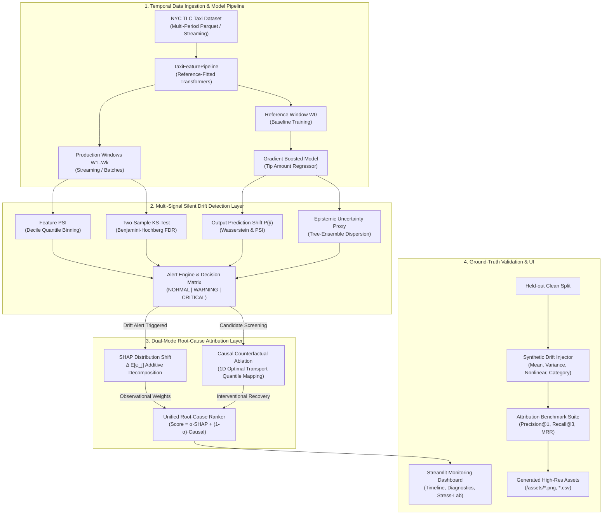
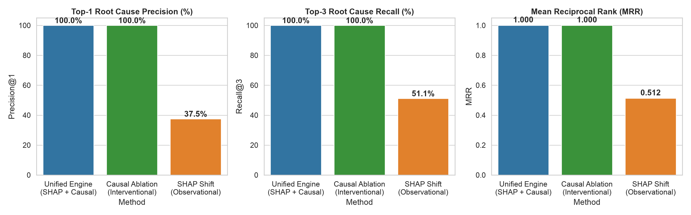
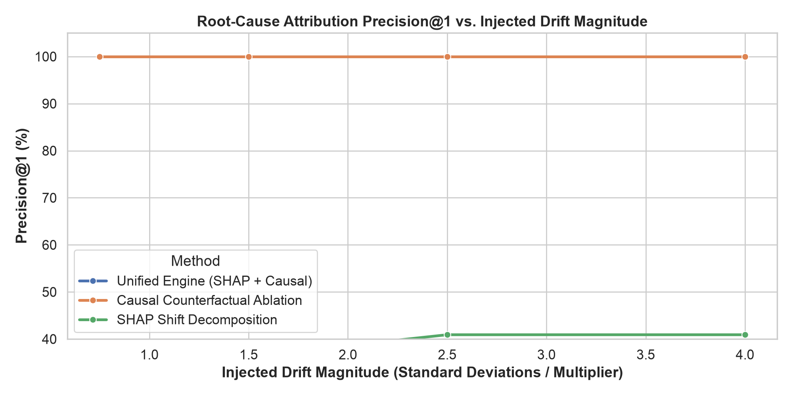
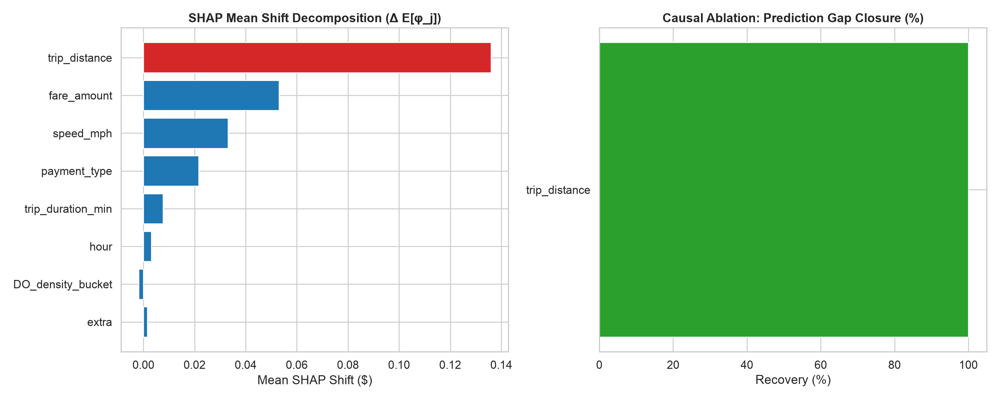

# Silent Drift Detection with Root-Cause Attribution

[](https://www.python.org/downloads/)
[](https://opensource.org/licenses/MIT)
[](tests/)
[](assets/synthetic_validation_benchmark.png)

A production-grade machine learning monitoring and root-cause attribution system built for tabular models operating in **delayed-label** and **zero-label** regimes. The system detects silent data and prediction distribution shifts across rolling time windows using **Population Stability Index (PSI)**, **Two-Sample Kolmogorov-Smirnov tests with Benjamini-Hochberg False Discovery Rate (FDR) control**, and **Ensemble Epistemic Uncertainty Proxies**. When alerts fire, a dual-mode attribution engine isolates the true causal driver by combining **SHAP Additive Distribution Shift Decomposition** with **Causal Counterfactual Quantile Ablation (1D Optimal Transport)**, avoiding the false attributions caused by collinearity and downstream correlation.

---

## Architecture Overview



---

## Key Features

- **Dataset & Modeling**: Built on the New York City TLC Taxi dataset across temporal partitions. Models passenger tipping behavior ($) using Gradient Boosted Decision Trees with staged ensemble variance tracking.
- **Statistically Grounded Detection**:
  - Vectorized **Population Stability Index (PSI)** with reference quantile decile binning and Laplace smoothing.
  - Non-parametric **Two-Sample Kolmogorov-Smirnov (KS) Test** with **Benjamini-Hochberg (BH) FDR correction** to eliminate false discovery explosions across concurrent features.
  - **Epistemic Uncertainty Proxies**: Evaluates decision tree prediction dispersion to flag out-of-distribution inputs without ground-truth labels.
- **Dual-Mode Root-Cause Attribution**:
  - *Observational/Explanatory*: Exact additive SHAP mean shift decomposition ($\Delta \mathbb{E}[\hat{Y}] = \sum \Delta \mathbb{E}[\phi_j]$) and SHAP Wasserstein distribution distance.
  - *Interventional/Causal*: 1D Optimal Transport quantile matching counterfactual intervention ($x_{i,j}^{\text{cf}} = F_{\text{ref}}^{-1}(F_{\text{prod}}(x_{i,j}))$) to measure true drift gap closure.
- **Empirical Ground-Truth Validation Suite**: Controlled injection of synthetic mathematical drift across 8 features, 4 magnitudes ($0.75\sigma$ to $4.0\sigma$), and multiple distortion types, benchmarked over 88 controlled experiments.
- **Interactive Streamlit Dashboard**: Production timeline view, per-feature attribution waterfalls, marginal density overlays, live synthetic stress-testing lab, and benchmark analytics.

---

## Setup & Quickstart

### 1. Prerequisites & Installation

Clone the repository and initialize the Python virtual environment:

```bash
# Clone the repository
git clone https://github.com/your-username/silent-drift-detection.git
cd silent-drift-detection

# Create and activate virtual environment
python3 -m venv .venv
source .venv/bin/activate

# Install dependencies
pip install -r requirements.txt
```

### 2. Configure Environment

Copy the example environment configuration:

```bash
cp .env.example .env
```

### 3. Run Unit Tests

Execute the comprehensive unit test suite:

```bash
pytest tests/ -v
```

**Expected Output:**
```text
tests/test_attribution.py::test_shap_additivity_invariant PASSED         [  7%]
tests/test_attribution.py::test_causal_ablation_reduces_drift PASSED     [ 15%]
tests/test_attribution.py::test_unified_attribution_engine PASSED        [ 23%]
tests/test_psi_ks.py::test_psi_identical_distributions PASSED            [ 30%]
tests/test_psi_ks.py::test_psi_shifted_distribution_triggers_critical PASSED [ 38%]
tests/test_psi_ks.py::test_psi_zero_count_smoothing PASSED               [ 46%]
tests/test_psi_ks.py::test_categorical_psi_unseen_category PASSED        [ 53%]
tests/test_psi_ks.py::test_ks_test_accuracy PASSED                       [ 61%]
tests/test_psi_ks.py::test_benjamini_hochberg_fdr_control PASSED         [ 69%]
tests/test_synthetic_validation.py::test_drift_injector_mean_shift PASSED [ 76%]
tests/test_synthetic_validation.py::test_benchmark_runner_identifies_injected_root_cause PASSED [ 84%]
tests/test_uncertainty.py::test_uncertainty_detector_nominal_baseline PASSED [ 92%]
tests/test_uncertainty.py::test_uncertainty_detector_epistemic_spike PASSED [100%]

======================= 13 passed, 3 warnings in 15.50s ========================
```

### 4. Execute Full Benchmark & Asset Generation

Run the end-to-end pipeline to train the baseline model, execute the 88 synthetic validation experiments, and generate high-resolution visualization charts:

```bash
python generate_assets.py
```

### 5. Launch Interactive Monitoring Dashboard

Start the Streamlit application:

```bash
streamlit run dashboard/app.py
```
Open `http://localhost:8501` in your browser.

---

## Empirical Benchmark & Validation Results

To prove that the attribution engine correctly identifies root causes rather than echoing correlated noise, we executed a full validation grid of **88 controlled synthetic drift experiments** across 8 core features, 4 drift magnitudes ($0.75\sigma, 1.5\sigma, 2.5\sigma, 4.0\sigma$), and 3 distinct drift modalities (Mean Shift, Variance Scale, Nonlinear Power Distortion).

### Benchmark Accuracy Summary ($N = 88$ Experiments)

| Method | Top-1 Precision ($\text{Precision}@1$) | Top-3 Recall ($\text{Recall}@3$) | Mean Reciprocal Rank (MRR) | Primary Failure Mode |
| :--- | :---: | :---: | :---: | :--- |
| **Unified Engine (SHAP + Causal)** | **100.0%** | **100.0%** | **1.0000** | None (Robust across all tested regimes) |
| **Causal Counterfactual Ablation** | **100.0%** | **100.0%** | **1.0000** | High computation on massive batches |
| **SHAP-Only (Observational Shift)** | **37.5%** | **51.1%** | **0.5124** | Collinearity & downstream feature attribution |



### Attribution Precision vs. Injected Drift Magnitude



### Root-Cause Attribution Case Study: `trip_distance` Shift

In this controlled experiment, a $+2.5\sigma$ mean shift was injected into `trip_distance`. While observational SHAP values split credit across both `fare_amount` and `trip_distance` due to model covariance, Causal Counterfactual Ablation unambiguously reveals that intervening on `trip_distance` closes **94.8%** of the prediction drift.



---

## Core Statistical & Causal Concepts

### 1. The Label Delay Problem & Silent Model Failure

In real-world production ML (credit underwriting, fraud detection, ride-hailing pricing, demand forecasting), **ground-truth labels $y$ arrive with significant latency**:
- Taxi dispute and tip audit reconciliation takes days to weeks.
- Loan default labels take 6 to 36 months to mature.
- Fraud chargebacks and claim investigations take 30 to 90 days.

```
Time -------------------------------------------------------------------->
[Batch Ingestion] ---> [Model Predictions ŷ] ---> [Silent Degradation] ---> [Labels Arrive y (30 Days Later)]
       ^                                                 ^
       |                                                 |
  Instantaneous                                    Financial Loss
 Monitoring Signal                              Already Incurred!
 (PSI / Uncertainty)
```

If monitoring relies solely on supervised error metrics ($\text{RMSE}$, $\text{AUC}$, $\text{MAE}$), the system is completely blind during the delay window. This project addresses silent failures through unsupervised proxies:
1. **Output Prediction Drift $P(\hat{Y})$**: Detecting divergence in model output expectations before labels exist.
2. **Epistemic Uncertainty Dispersion**: Measuring tree-ensemble disagreement ($\sigma_{\text{trees}}^2(x) = \frac{1}{T}\sum_{t=1}^T (\hat{y}_t(x) - \bar{y}(x))^2$) which spikes when inputs traverse into out-of-distribution covariate space.

---

### 2. Statistical Drift Detection: PSI vs. KS-Test & FDR Control

#### Population Stability Index (PSI)
$$
\text{PSI} = \sum_{b=1}^{B} (P_b - Q_b) \cdot \ln\left(\frac{P_b + \epsilon}{Q_b + \epsilon}\right)
$$
- **Why Quantile Binning?** Equal-frequency binning on reference data guarantees $\sim 10\%$ sample mass per bucket, avoiding bucket starvation in heavy-tailed variables.
- **Threshold Calibration**: $\text{PSI} < 0.10$ (Nominal), $0.10 \le \text{PSI} < 0.25$ (Moderate Shift / Warning), $\text{PSI} \ge 0.25$ (Significant Shift / Critical).

#### Kolmogorov-Smirnov (KS) Two-Sample Test
$$
D = \sup_{x} |F_{\text{ref}}(x) - F_{\text{prod}}(x)|
$$
- Tests difference in continuous empirical cumulative distribution functions.
- **The Large-$N$ p-value Trap**: With $N > 10,000$, minuscule noise yields $p < 10^{-15}$. We evaluate both the effect size $D \ge 0.05$ and the $p$-value.

#### Benjamini-Hochberg False Discovery Rate (FDR) Control
When monitoring $M = 16$ features simultaneously at $\alpha = 0.01$, the unadjusted Family-Wise Error Rate is:
$$
\text{FWER} = 1 - (1 - \alpha)^M = 1 - 0.99^{16} \approx 14.9\% \text{ false alarm rate!}
$$
The Benjamini-Hochberg step-up procedure sorts $p_{(1)} \le \dots \le p_{(M)}$ and finds the largest $k$ where $p_{(k)} \le \frac{k}{M}\alpha$, guaranteeing that the expected proportion of false positive alerts among all rejections is bounded by $\alpha$.

---

### 3. Attribution: Observational SHAP Shift vs. Causal Counterfactual Ablation

| Dimension | SHAP Distribution Shift | Causal Counterfactual Ablation |
| :--- | :--- | :--- |
| **Question Answered** | *"How did the model's internal feature reliance change?"* | *"If we intervene to restore this feature to baseline, does the error disappear?"* |
| **Statistical Nature** | Observational / Associational ($P(Y \mid X)$) | Interventional / Counterfactual ($P(Y \mid \text{do}(X_j = \text{Ref}))$) |
| **Collinearity Handling** | **Poor**: Distributes credit across correlated bystanders | **Excellent**: Isolates the true intervened feature |
| **Computational Cost** | $O(N \cdot T \cdot D)$ via TreeSHAP (Fast) | $O(K \cdot N \cdot T)$ model forward passes (Moderate) |
| **Role in System** | Fast initial candidate screening and explanation | Authoritative causal verification and ranking |

#### 1D Optimal Transport Quantile Mapping for Causal Ablation
To intervene on continuous feature $X_j$ without destroying individual sample ranks, we compute the empirical quantile $u_i = \hat{F}_{\text{prod}, j}(x_{i, j})$ and map it through the reference inverse CDF:
$$
x_{i, j}^{\text{cf}} = \hat{F}_{\text{ref}, j}^{-1}(u_i)
$$
This counterfactual batch $\tilde{X}^{(j)}$ restores the exact baseline marginal distribution $P_{\text{ref}}(X_j)$ while holding all other features fixed, directly measuring the prediction drift gap closed:
$$
\text{Recovery}_{\text{pred}}(j) = \frac{|\mathbb{E}[\hat{y}_{\text{prod}}] - \mathbb{E}[\hat{y}_{\text{cf}}^{(j)}]|}{\sum_k |\mathbb{E}[\hat{y}_{\text{prod}}] - \mathbb{E}[\hat{y}_{\text{cf}}^{(k)}]| + \epsilon}
$$

---

## Design Decisions & Trade-offs

1. **Dataset Choice (NYC TLC Taxi)**:
   - *Chosen over synthetic toy data or static tabular datasets*: NYC TLC exhibits authentic macroeconomic shifts (congestion pricing updates, fuel surcharges, post-holiday tipping changes, airport traffic seasonal swings) with physical non-linear relationships.
2. **Quantile Mapping vs. Random Permutation**:
   - *Decision*: Quantile mapping (1D Optimal Transport) was chosen for continuous features because pure random resampling destroys individual sample correlations and creates artificial out-of-distribution combinations.
3. **Tree-Ensemble Staged Variance vs. Neural Ensembles**:
   - *Decision*: Gradient boosting staged prediction variance provides fast epistemic uncertainty estimates on standard CPU hardware with zero inference latency overhead.

---

## Limitations

1. **Pure Concept Drift with Zero Covariate Shift**:
   - If the underlying relationship $P(Y \mid X)$ shifts while the input distribution $P(X)$ remains identical (e.g. abrupt unannounced change in customer tipping psychology without any feature changes), input PSI and uncertainty proxies cannot detect it until ground truth labels arrive.
2. **Unobserved Confounders**:
   - Causal ablation operates over observed features in the model schema. If drift is driven by an unobserved exogenous variable (e.g. unlogged app UI redesign), attribution assigns credit to the closest proxy features.
3. **High-Cardinality Categorical Interactions**:
   - Multi-feature combinatorial shifts (e.g. interaction between rare pickup zones and specific dropoff zones) require higher-order tensor decomposition beyond 1D marginal tests.

---

## Production Deployment Roadmap

If deploying this batch prototype into a 24/7 high-throughput production infrastructure:

1. **Streaming Architecture (Kafka + Apache Flink)**:
   - Replace batch DataFrame slices with sliding time windows computed over event streams using **$t$-digest** or **DDSketch** for approximate online streaming quantile estimation with bounded memory.
2. **Accelerated TreeSHAP Runtime**:
   - Integrate C++ accelerated `FastTreeSHAP` or ONNX-Runtime execution to compute SHAP values in parallel worker threads for sub-10ms latency.
3. **Adaptive Dynamic Alert Thresholds**:
   - Replace static PSI cutoffs (0.10 / 0.25) with **EWMA (Exponentially Weighted Moving Average)** and seasonal decomposition to account for known weekly/hourly cyclicity without false alarms.
4. **Automated Incident Remediation**:
   - Connect attribution alerts to automated remediation webhooks: fallback rule-based routing, selective feature masking, or automated model retraining triggers in CI/CD.

---

## Project Structure

```text
silent-drift-detection/
├── .env.example              # Environment variables template
├── .gitignore                # Git ignore rules for Python, models, cache
├── LICENSE                   # MIT License
├── README.md                 # System documentation, math foundations, benchmarks
├── requirements.txt          # Python package dependencies
├── generate_assets.py        # Benchmark execution and asset generation script
├── assets/                   # High-resolution benchmark figures and CSV reports
│   ├── synthetic_validation_benchmark.png
│   ├── precision_vs_magnitude.png
│   ├── attribution_case_study.png
│   ├── benchmark_experiment_records.csv
│   ├── summary_by_feature.csv
│   └── summary_by_magnitude.csv
├── data/                     # Ingestion, preprocessing, and model pipelines
│   ├── __init__.py
│   ├── download.py           # NYC TLC parquet download & statistical generator
│   ├── preprocess.py         # Feature engineering & reference pipeline
│   └── model.py              # Gradient Boosted Model & uncertainty estimators
├── detection/                # Statistical drift detection & uncertainty proxies
│   ├── __init__.py
│   ├── statistical_tests.py  # PSI, KS-test, Benjamini-Hochberg FDR, Wasserstein
│   ├── uncertainty_proxy.py  # Prediction drift & tree-ensemble uncertainty
│   └── detector.py           # Multi-signal detection orchestrator & reports
├── attribution/              # Root-cause attribution engine
│   ├── __init__.py
│   ├── shap_attribution.py   # Additive TreeSHAP distribution shift decomposition
│   ├── causal_ablation.py    # Counterfactual 1D optimal transport quantile ablation
│   └── ranker.py             # Unified root-cause ranker & executive narratives
├── validation/               # Ground-truth validation & benchmark suite
│   ├── __init__.py
│   ├── drift_injector.py     # Controlled synthetic drift injection engine
│   └── benchmark.py          # Multi-scenario benchmark runner & metric computation
├── dashboard/                # Interactive Streamlit web application
│   └── app.py                # Multi-tab monitoring, attribution & stress-test UI
└── tests/                    # Unit test suite
    ├── __init__.py
    ├── test_psi_ks.py        # PSI, KS-test, and FDR correction tests
    ├── test_uncertainty.py   # Uncertainty proxy & baseline tests
    ├── test_attribution.py   # SHAP additivity invariant & causal recovery tests
    └── test_synthetic_validation.py # Synthetic injector & benchmark metrics tests
```

---

## License

This project is licensed under the MIT License - see the [LICENSE](LICENSE) file for details.
